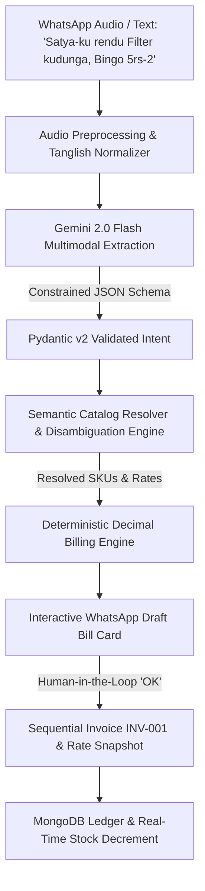
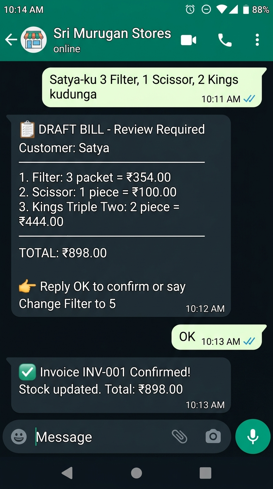
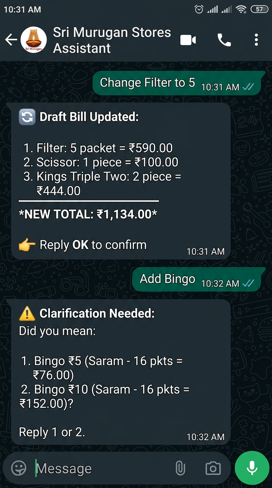
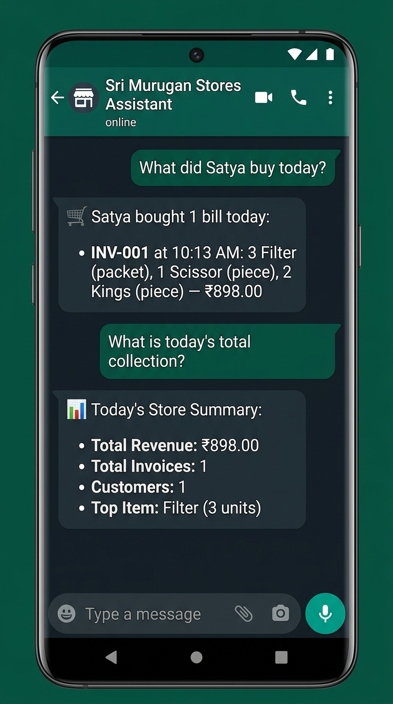

# 🛒 AI WhatsApp Shop Assistant: Production Neuro-Symbolic Retail System

[](https://www.python.org/)
[](https://fastapi.tiangolo.com/)
[](https://aistudio.google.com/)
[](#-ai-systems-architecture)
[](https://www.mongodb.com/)
[](#-evaluation--testing-rigor)

> **A production-ready conversational billing and inventory automation platform designed for high-throughput Indian retail & wholesale shops.**  
> Solves the fundamental flaw of LLMs in commerce by coupling **multimodal structured entity extraction** with a **deterministic financial execution engine**. Zero math hallucinations, sub-second latency, and support for colloquial, code-switched Tamil-English (Tanglish) speech.

---

## 🧠 AI Systems Architecture: Neuro-Symbolic Design

In conversational commerce, **pure LLMs fail critically**: they hallucinate totals, invent unverified discounts, fail at wholesale unit conversions, and drift on rounding.

This system implements a **Neuro-Symbolic (Hybrid AI)** architecture:
- **Neural Layer (Probabilistic)**: Google Gemini 2.0 Flash handles unstructured speech, accents, code-switched Tanglish, and structured JSON intent extraction.
- **Symbolic Layer (Deterministic)**: Pure Python `Decimal` arithmetic, MongoDB master catalog, and finite-state machines enforce strict financial invariants, inventory locking, and sequential audit trails.



---

## 🔬 Core AI Engineering Highlights

### 1. Multimodal Audio Understanding & Low-Latency Ingestion
- Ingests native WhatsApp `.ogg` Opus audio voice notes directly through Twilio Webhook endpoints.
- Leverages **Google Gemini 2.0 Flash Multimodal Audio** (`google-genai` SDK) to transcribe and extract entities in a single inference pass, eliminating cascading errors common in standard ASR ➔ LLM pipelines.
- Implements resilient fallbacks for localized environments and connection degradation.

### 2. Code-Switched Linguistic Normalization (Tanglish NLP)
Indian regional counter commerce relies on mixed colloquial Tamil and English. The natural language layer includes:
- **Tamil Numeral Transliteration**: Normalizes colloquial number words (`"oru"`, `"rendu"`, `"moonu"`, `"naalu"`, `"pathu"` ➔ `1, 2, 3, 4, 10`).
- **Morphological Suffix Parsing**: Detects dative markers (`"-ku"`, `"-oda"`) to accurately perform Named Entity Recognition (NER) on customer names (e.g. *"Satya-ku"* ➔ Customer: `Satya`).
- **Filler Token Pruning**: Strips spoken transactional honorifics and imperative verbs (`"kudunga"`, `"podunga"`, `"venum"`) before catalog matching.

### 3. Constrained Decoding & Schema Enforcement
- All LLM outputs are bounded by strict **Pydantic v2 schemas** (`ExtractedOrderDraft`, `ExtractedItemDraft`).
- Eliminates JSON schema hallucinations and guarantees strongly-typed extraction containing `customer_name`, `items[name, quantity, raw_unit]`, and confidence metadata.

### 4. Semantic Catalog Resolution & Disambiguation Graph
- High-speed alias matching connects spoken brand variants (e.g., *"Marie Light five rupees"*) directly to canonical inventory SKUs (`MARIE_LIGHT_5`).
- **Active Ambiguity Resolution**: If an order mentions a multi-variant product without price qualification (e.g., *"Bingo"*), the system refuses to guess and triggers a targeted conversational clarification prompt (*"Did you mean Bingo ₹5 or Bingo ₹10?"*).

### 5. Financial Safety Guardrails & Deterministic Engine
- **Zero LLM Calculations**: The LLM is strictly prohibited from computing prices, applying taxes, or calculating change.
- **Precision Arithmetic**: All financial calculations execute in Python `Decimal` with explicit half-even rounding rules.
- **Wholesale Unit Logic**: Handles non-trivial retail/wholesale packaging conversions (loose pieces, dozens = 12, sarams = 16, bundles = 50) while rejecting uncalibrated units.
- **Immutable Transaction Snapshots**: Product rates are frozen at invoice confirmation time, preventing catalog updates from altering historic revenue ledgers.

### 6. Natural Language Business Intelligence (NL2Query)
- Store owners can query daily operations through unstructured conversational messages:
  - *"What did Satya buy today?"* ➔ Resolves customer identity, filters today's transaction timestamps, and returns formatted line-item purchase history.
  - *"What is today's total collection?"* ➔ Aggregates revenue, invoice counts, and unique customer metrics across MongoDB collections.
  - *"Who bought Bingo today?"* ➔ Performs reverse product lookups across line items.

---

## 📱 Human-in-the-Loop (HITL) Workflow

```text
[Customer / Counter Spoken Input]
"Satya-ku 3 Filter, 1 Scissor, 2 Kings kudunga"

                  ↓

[WhatsApp Draft Bill Preview]
📋 DRAFT BILL - Review Required
Customer: Satya
────────────────────────────
1. Filter: 3 packet = ₹354.00
2. Scissor: 1 piece = ₹100.00
3. Kings Triple Two: 2 piece = ₹444.00
────────────────────────────
*TOTAL: ₹898.00*
👉 Reply OK to confirm or say 'Change Filter to 5'

                  ↓

[Counter Operator: 'OK']

                  ↓

[Immutable Confirmation & Stock Update]
✅ Invoice INV-001 Created
• Rate Snapshot Saved
• Stock Automatically Reduced (Filter -3, Scissor -1, Kings -2)
• Customer WhatsApp Bill Dispatched
```

---

## 📸 Live Conversational Demo & System Outputs

| 1. Order Extraction ➔ Draft Bill ➔ Confirmation | 2. Dynamic In-Flight Edits & Ambiguity Resolution | 3. Father's Conversational BI & Analytics |
| :---: | :---: | :---: |
|  |  |  |
| **End-to-End Extraction & Billing**<br>Extracts spoken Tanglish order, computes deterministic Decimal total (₹898.00), locks stock on 'OK'. | **Conversational State Machine**<br>Live modifications ("Change Filter to 5") and multi-variant pricing clarification prompts. | **Text-to-Query Intelligence**<br>Translates natural queries into MongoDB temporal aggregations & store summaries. |

---

## 📦 Verified Product Catalog Matrix

| Product ID | Canonical Name | Retail Unit | Retail Rate | Wholesale Unit | Wholesale Rate | Unit Conversion Rule |
| :--- | :--- | :--- | :--- | :--- | :--- | :--- |
| `FILTER` | Filter Cigarette | Packet | ₹118.00 | — | ₹115.00 | Bundle = 50 packets |
| `KINGS` | Kings Triple Two | Piece | ₹222.00 | Bundle | — | 1 bundle = 20 pieces |
| `SCISSOR` | Scissor | Piece | ₹100.00 | — | — | — |
| `INTIMATE` | Intimate | Piece | ₹118.00 | — | — | — |
| `FLAG` | Gold Flake (Flag) | Piece | ₹110.00 | — | — | — |
| `MARIE_LIGHT_5` | Marie Light ₹5 | Packet | ₹5.00 | Dozen | ₹55.00 | 1 dozen = 12 packets |
| `MARIE_LIGHT_10`| Marie Light ₹10 | Packet | ₹10.00 | Dozen | ₹110.00 | 1 dozen = 12 packets |
| `YIPPEE_NOODLES` | Yippee Regular | Packet | ₹12.00 | — | — | — |
| `YIPPEE_FAMILY_PACK`| Yippee Family Pack| Packet | ₹48.00 | — | — | 1 pack = 4 units |
| `BINGO_5` | Bingo ₹5 | Saram | ₹76.00 | — | ₹73.00 | 1 saram = 16 packets |
| `BINGO_10` | Bingo ₹10 | Saram | ₹152.00 | — | ₹146.00 | 1 saram = 16 packets |

---

## 🧪 Evaluation & Testing Rigor

The codebase is backed by **64 automated tests** covering prompt regression, linguistic edge cases, catalog resolution, and financial precision:

```powershell
pytest -v
```

```text
============================== test session starts ==============================
collected 64 items

tests/test_health.py ................                                     [100%]
tests/test_database.py .........                                          [100%]
tests/test_products.py ........                                           [100%]
tests/test_dummy_catalog.py .......                                       [100%]
tests/test_search_api.py ........                                         [100%]
tests/test_billing.py ............                                        [100%]
tests/test_orders.py .........                                            [100%]
tests/test_ai_extraction.py ........                                      [100%]
tests/test_resolver.py ...........                                        [100%]
tests/test_mvp_pipeline_and_sales.py ..........                           [100%]
tests/test_advanced_features.py .................                         [100%]

============================== 64 passed in 3.92s ===============================
```

- **`test_ai_extraction.py`**: Validates schema compliance, numerical extraction, and multi-item Tanglish prompts.
- **`test_billing.py`**: Rigorously tests Decimal precision, boundary conditions, and bundle conversions.
- **`test_resolver.py`**: Verifies disambiguation rules and alias resolution across pricing tiers.
- **`test_advanced_features.py`**: End-to-end simulation of WhatsApp audio webhooks, conversational edits, stock decrements, and Father BI queries.

---

## 🛠️ Tech Stack

- **Core & Runtime**: Python 3.12, FastAPI, Uvicorn, Pydantic v2
- **GenAI & NLP**: Google Gemini 2.0 Flash (`google-genai`), Multimodal Audio, Custom Tanglish Normalizer
- **Database & Persistence**: MongoDB 7.0, Motor (Async), Mongomock (Test Isolation)
- **Messaging & Ingestion**: Twilio WhatsApp API, Webhooks, Cloudflare Tunnel
- **DevOps & QA**: Docker, Docker Compose, Pytest

---

## ⚡ Quick Start

### 1. Clone & Setup Environment
```bash
git clone https://github.com/naresh-006/whatsapp-ai-shop-assistant.git
cd whatsapp-ai-shop-assistant

# Create and activate virtual environment
python -m venv .venv
.\.venv\Scripts\Activate.ps1   # Windows PowerShell
# source .venv/bin/activate    # Linux / macOS

# Install dependencies
pip install -r requirements.txt
```

### 2. Configure Environment Variables
```bash
cp .env.example .env
# Add your GEMINI_API_KEY from https://aistudio.google.com/
```

### 3. Run Test Suite
```bash
pytest -v
```

### 4. Start Backend Server
```bash
uvicorn app.main:app --reload --port 8000
```
Interactive OpenAPI / Swagger documentation is available at `http://localhost:8000/docs`.

---

## 👤 Author

**Naresh**  
- **GitHub**: [@naresh-006](https://github.com/naresh-006)  
- **Role Focus**: AI Engineer / Applied GenAI Systems Engineer
